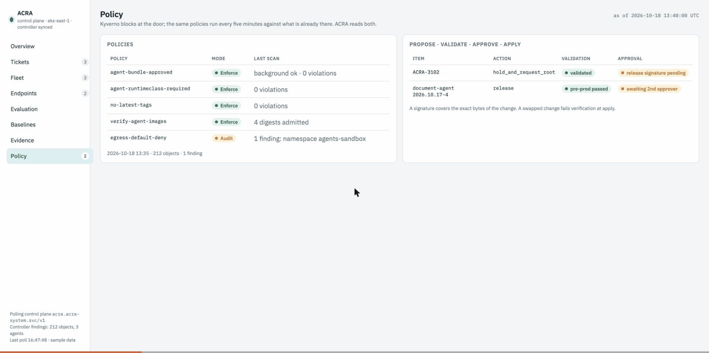
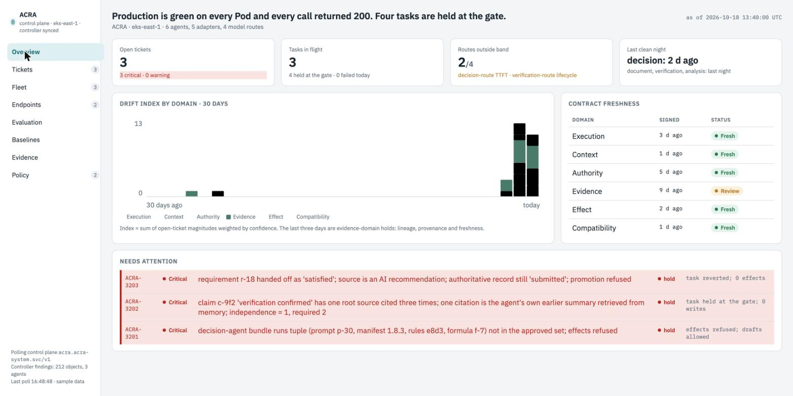
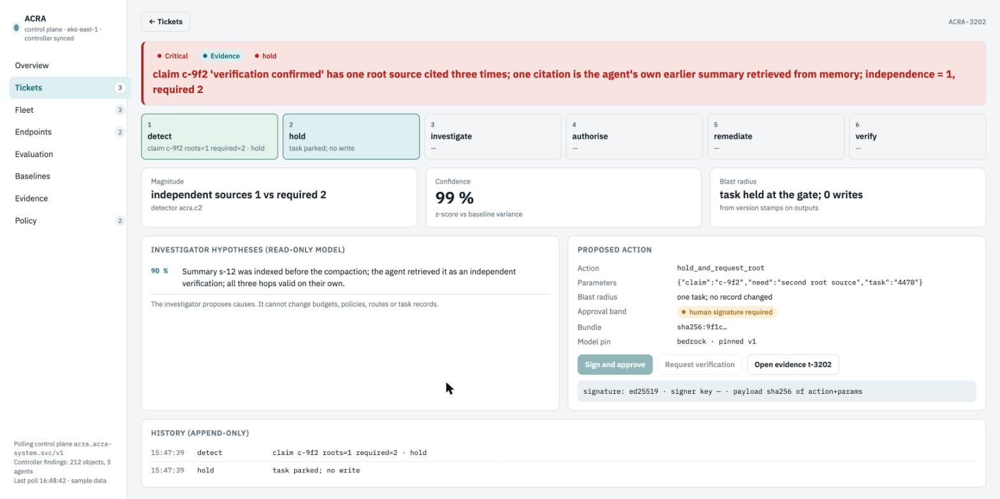

<div align="center">

# ACRA — Agentic Control & Runtime Assurance

**Proof that your AI agents stayed inside the lines — on Kubernetes, continuously.**


</div>

> *Every call returned 200. Every agent passed its own check. The approval at the end was one nobody authorized.*

That's **combinative drift** — correct components composing into an outcome no one approved. Single-layer checks miss it. ACRA is the layer that reads the *composition*, holds it at the gate, and hands you a signed evidence chain an auditor can actually read.



*Everything green → inject a drift → the gate HOLDs it, a ticket opens, and the evidence shows `independence = 1, required 2`. Nothing faked — that's the real gate running.*

---

## Why this exists

Regulators ask one question: **"Can you prove this did what you said?"** For normal software, CI/CD is the proof. AI agents break it — same image, same manifest, *different answer*; GitOps shows zero changes while behavior drifts. And there's no settled rule for AI agents yet, so the proof has to come from **your own controls, continuously.**

ACRA is a deterministic control plane beside your agents. Agents **propose**; the gate **admits or holds** every consequential write; every decision emits a **signed, queryable proof**.

## See it in 60 seconds

**No cluster — just Go:**
```bash
make run                       # console at http://localhost:8080
make inject KIND=combinative   # watch the gate HOLD it
```

**On Kubernetes (kind):**
```bash
make up                        # cluster + image + CRD + operator + OTel + deploy
open http://localhost:8080
make inject KIND=independence  # or: epoch · authority · schema · … (12 kinds)
kubectl get agentpolicy        # the operator reports drift on the cluster itself
```

<div align="center">


</div>

## How it works — 4 Kubernetes-native patterns

1. **Behavioral-baseline gate** — Kyverno admission enforces the approved set; the gate computes drift & evidence independence and holds what's outside it.
2. **Continuous proof via OpenTelemetry** — every gate decision emits a span with operational IDs + `acra.*` proof attributes.
3. **CRD controller → re-approval** — a `controller-runtime` operator watches `AgentPolicy` and reports/drives drift.
4. **Automated evidence** — cluster telemetry becomes an auditor-queryable, signed chain, not a spreadsheet.

## "Isn't this just Kyverno + OpenTelemetry?"

Fair question — and the answer is the whole point. Each of those secures *a layer*: Kyverno admits pods, OTel correlates traces, OPA evaluates policy, SPIFFE proves identity. **None of them, alone, can tell you whether correct components composed into an *authorized* outcome.** A green admission check is not business truth; a successful trace is not an authoritative receipt. ACRA layers *on top of* them — reusing Kyverno, OTel and SPIFFE — and adds the gate + signed evidence that read the whole chain. → [How ACRA relates to the ecosystem](docs/08-landscape.md)

## What's inside

**Drift control (v0.1, unchanged)**

- **Gate + 12 detectors** — combinative drift, evidence independence (roots, not citations), epoch fencing, authority-at-now, and 8 more — all unit-tested. Also served over HTTP by `acra-gate`.
- **Signed evidence chain** — append-only, ed25519, hash-chained, with a tail anchor so truncation is detected.
- **Operator** — `kubectl get agentpolicy` shows live `Phase` / open tickets; it reports `Unknown` (not green) when the apiserver is unreachable.
- **OpenTelemetry** → collector. **Kyverno** admission policy. **Live console.**
- **Grounded in a taxonomy** — the 12 detectors are a principled subset of **72 drift checks across 12 domains** ([drift taxonomy](docs/07-drift-taxonomy.md)).

**Agent reliability pipeline (v0.2)**

- **OTLP ingest from any namespace** → normalized events → one *run* per agent execution.
- **Agent contracts** — versioned, machine-checkable: output schema, forbidden patterns, tool allowlist and call/retry limits, latency, token and context budgets, optional LLM rubrics. Deterministic checks run first; missing telemetry is `unknown`, never a pass.
- **Incidents** — violations are deduplicated into incidents with a signed audit trail.
- **Root-cause analysis** — a bounded state machine. Rules produce ranked hypotheses and confidence; an optional LLM only writes the narrative and must cite real evidence. Recommended actions are advice, never executed.
- **Read-only evidence adapters** — Kubernetes (pods, events, logs; namespace allowlist), Azure Log Analytics, AWS CloudWatch Logs (in-process SigV4, IRSA), GCP Cloud Logging, KAgent (advisory only). A failed source is reported as unavailable, never as "clean".
- **Access control and safety** — reader / ingest / admin roles, redaction, query-injection defence on every cloud query, https-only endpoints, a read-only tool gateway with an audit trail.
- **MCP and A2A servers** — `POST /mcp` exposes the read-only tools to MCP clients, and `POST /a2a` plus the Agent Card (`/.well-known/agent-card.json`) lets peer agents list and investigate incidents. Both are on by default under Helm and sit behind the same bearer tokens.
- **Memory rules in contracts** — cap and inspect an agent's calls to the memory tools you name (write/read counts, write size, forbidden content).
- **Optional Valkey** — shares the gate's epoch fence across restarts and replicas (`valkey.enabled`). It holds only epochs.
- **Helm chart** — apiserver, gate, operator, OTLP collector, RBAC, PVC, secrets, optional NetworkPolicy: [`deploy/helm/acra`](deploy/helm/acra).

## Run it in your cluster

```bash
helm upgrade --install acra deploy/helm/acra -n acra-system --create-namespace \
  --set image.repository=ghcr.io/deepnavakoti/acra --set image.tag=0.2.0 \
  --set 'adapters.kubernetes.namespaces={agents,kagent}'

# admin token, then the console
kubectl -n acra-system get secret acra-auth -o jsonpath='{.data.api-token}' | base64 -d
kubectl -n acra-system port-forward svc/acra-apiserver 8080:80
```

Then point agents in **any namespace** at the collector
(`OTEL_EXPORTER_OTLP_ENDPOINT=http://acra-collector.acra-system.svc:4317`),
register a contract per agent, and enable the cloud adapters you use:

```yaml
# values.yaml (excerpt)
adapters:
  kubernetes: { enabled: true, namespaces: [agents, kagent, payments] }
  azure:      { enabled: true, workspaceId: <log-analytics-guid> }
  aws:        { enabled: true, region: us-east-1, logGroups: [/eks/agents/app] }
  gcp:        { enabled: true, project: my-project }
  kagent:     { enabled: true, url: https://kagent.kagent.svc }   # advisory only
serviceAccount:
  annotations: {}   # IRSA / Azure workload identity / GKE Workload Identity
```

**How ACRA works across namespaces, KAgent and cloud services — what it reads, the identities and permissions it needs, the data flow, and every known limit — is in [docs/09-cluster-and-cloud-operations.md](docs/09-cluster-and-cloud-operations.md).**

## The design, written down

Most OSS has no design docs. ACRA is spec-first — the thinking is in [`docs/`](docs/): [vision](docs/01-vision-scope.md) · [architecture](docs/02-architecture.md) · [the algorithms](docs/03-core-specs.md) · [API & schemas](docs/04-api-and-schemas.md) · [layout & run](docs/05-repo-layout-and-run.md) · [build plan](docs/06-build-plan.md) · [drift taxonomy](docs/07-drift-taxonomy.md) · [ecosystem & landscape](docs/08-landscape.md) · [cluster & cloud operations](docs/09-cluster-and-cloud-operations.md).

## Status and honest limits

ACRA v0.2 builds, vets and passes its unit tests, and the Helm chart passes `helm lint` and `helm template`. It has **not** been installed on a live cluster or run against real Azure, AWS or GCP accounts; those adapters are tested against fake servers only. Other limits:

- Single node: bbolt stores on one PVC, one apiserver replica, no HA.
- The KAgent A2A endpoint and method are unverified against a real KAgent.
- The MCP and A2A servers are tested only with unit and integration tests, not a real MCP client, A2A peer or KAgent. A2A is synchronous only and MCP has no SSE or sessions.
- The Valkey epoch store is tested against a fake RESP server, not a real Valkey.
- OTLP/JSON only into the apiserver (the bundled collector converts).
- RCA is a Go state machine, not LangGraph. The incident index is not tenant-scoped.
- Cloud and cluster evidence is only found where your telemetry carries trace ids, agent ids and service names.

Treat it as a reference implementation to evaluate and harden, not a drop-in production control. Full list: [section 10 of the operations doc](docs/09-cluster-and-cloud-operations.md#10-limits-and-what-has-not-been-proven).

## Why I built it

> I've spent 12 years running banking infrastructure on Kubernetes. When teams started putting AI agents into regulated workflows, I kept hitting the same wall: every component was green, every check passed, and the *combination* still did something no one signed off on — and I couldn't *prove* what happened after the fact. ACRA is the control plane I wished I'd had: it reads the composition, holds what drifted, and leaves a signed trail. Built it as a reference so others don't have to start from zero.

## Roadmap

Bring-your-own-agents (real frameworks) · protobuf/gRPC ingest · HA store (PostgreSQL) and multi-tenant isolation · verify adapters against live clouds and KAgent · model-provider gateways (Kong, SPIRE/SPIFFE) · `controller-gen` codegen.

Issues and ideas welcome — see [CONTRIBUTING](CONTRIBUTING.md).

## License

Apache-2.0.
