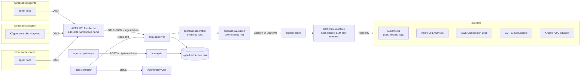

# ACRA in a cluster: how it works across namespaces, agents, KAgent and cloud services

This document explains what ACRA does once it runs next to real agents: how it
sees every namespace, what it reads from each system, what it never touches, and
what you must configure. Section 10 lists what is not done or not yet proven.

## 1. The model in one picture



ACRA is a control plane beside the agents. It observes, evaluates, opens
incidents and explains them. It does not restart pods, change configuration or
call write APIs on any cloud or cluster. The only thing that can block an agent
action is the gate, and only for callers that choose to call it.

## 2. Components

| Component | Runs as | Job |
|---|---|---|
| `acra-apiserver` | Deployment, 1 replica | `/v1` API, console, ingest, contract registry, evaluation, incidents, RCA, tool gateway, signed evidence store |
| `acra-gate` | Deployment | `POST /v1/gate/evaluate`: runs the detectors against a proposed write and returns `ADMIT` or `HOLD` |
| `acra-controller` | Deployment | Watches `AgentPolicy` objects in all namespaces and writes live drift status onto them |
| OTLP collector | Deployment | Receives OTLP from agents in any namespace, adds namespace and pod labels, forwards OTLP/JSON to the apiserver |

Everything installs with one Helm release (section 9).

## 3. How every namespace and agent is covered

Coverage has three independent parts. Missing any one degrades the result, and
ACRA reports the gap instead of hiding it.

### 3.1 Telemetry in: any namespace, no per-namespace install

Agents send OTLP to the collector Service
(`http://<release>-acra-collector.<ns>.svc:4317` gRPC or `:4318` HTTP). Pods in
any namespace can reach a ClusterIP Service, so nothing is deployed per
namespace. The collector's `k8sattributes` processor looks up the sender pod and
stamps `k8s.namespace.name`, `k8s.pod.name`, `k8s.deployment.name` and
`k8s.node.name`. Agents do not have to set the namespace themselves.

Each agent span should carry:

| Attribute | Used for |
|---|---|
| `acra.agent.id` (or `gen_ai.agent.id`, else `service.name`) | which agent and which contract |
| `acra.contract.version` | which contract version the run claims |
| `acra.kind` | `agent.request`, `agent.response`, `tool.call`, `model.call`, `error`, `infra`, `log` |
| `gen_ai.request.model`, `gen_ai.usage.input_tokens` / `output_tokens` | model calls and provider-reported token usage |
| `gen_ai.tool.call.id`, `acra.attempt` | tool calls and retry counting |
| `http.response.status_code` | upstream status |
| `acra.tenant.id`, `session.id`, `acra.agent.run.id` | grouping |

If `acra.kind` is absent, a span with `gen_ai.request.model` is treated as a
model call. Events that fail validation (missing agent id or trace id, oversized
payloads, span floods) are rejected, and the ingest response lists the reasons.

Reaching the collector is also the only network path ACRA needs from agent
namespaces. To restrict it, enable `networkPolicy` in the chart and list the
namespace labels allowed to send.

Only OTLP/JSON reaches the apiserver. The bundled collector converts for you. If
you export directly from an agent, use the HTTP/JSON protocol to
`POST /v1/traces`.

### 3.2 Contracts: what "correct" means for each agent

Telemetry alone says what happened, not what should have happened. Each agent
needs a contract registered by an admin:

```json
{
  "id": "support-v1", "agentId": "support", "version": "1",
  "outputSchema": {"type": "object", "required": ["answer"]},
  "forbiddenPatterns": ["(?i)api[_-]?key"],
  "tools": {"allowed": ["search", "ticket.create"], "maxCalls": 20, "maxRetries": 3},
  "limits": {"maxLatencyMs": 30000, "maxTotalTokens": 50000, "maxContextUtilization": 0.9}
}
```

```bash
curl -H "Authorization: Bearer $TOKEN" -X PUT $ACRA/v1/contracts -d @contract.json
```

Unknown fields are rejected, so a misspelt limit fails loudly instead of
silently never firing. A run with no matching contract (no contract for that
agent id and contract version) is not evaluated and no incident is opened. It is
counted in the pipeline's no-contract counter (`GET /v1/pipeline/stats`) so the
gap is visible, and it is never recorded as a pass.

**Memory rules.** ACRA cannot see inside an agent's memory store. It checks the
tool calls the agent made to it, so you name the memory tools yourself:

```json
"memory": {
  "writeTools": ["memory.save"], "readTools": ["memory.search"],
  "maxWrites": 5, "maxReads": 20, "maxWriteBytes": 4096,
  "forbiddenWritePatterns": ["AKIA[0-9A-Z]{16}", "(?i)password\\s*[:=]"]
}
```

- A tool not listed is not treated as memory.
- Violations are `memory.maxWrites`, `memory.maxReads`, `memory.writeBytes` and
  `memory.forbiddenWrite[i]`. Pattern matches are not echoed in the message.
- If a write call's input was not captured, the result is `unknown`
  (`memory.inputCaptured`), never a pass.
- Memory tools still need to be in `tools.allowed` when you use an allowlist.
- A contract is rejected if a memory rule has no matching tool list, if a name is
  both a read and a write tool, or if a limit is negative or a regex is invalid.

### 3.3 Cluster and cloud evidence: scoped, allowlisted, read-only

When a run violates its contract, the RCA step asks the adapters for evidence
around the run's time window. The query is keyed on the trace id, agent id,
service name and namespace taken from the run.

The Kubernetes adapter only reads namespaces on `adapters.kubernetes.namespaces`.
It selects pods with the label `app=<service.name>`, so agent Deployments should
carry that label, or set `service.name` to match. A namespace not on the list
yields "namespace not allowed", reported as an unavailable source.

## 4. What ACRA reads from each system

All adapters are read-only and optional. Each returns normalized signals plus a
`partial` flag. A failed or truncated source is listed in the report as
unavailable or partial. It is never treated as "no problems".

| Source | How it is queried | Correlation keys it expects in your data | Identity |
|---|---|---|---|
| Kubernetes | client-go: list pods, list events, read pod logs, only in allowlisted namespaces | pod label `app=<service.name>`; namespace from the run | in-cluster ServiceAccount, Role or ClusterRole from the chart |
| Azure | Log Analytics REST, KQL over `AppTraces`, `AppExceptions`, `AppDependencies` | `OperationId == traceId`, `Properties["agent_id"]`, `AppRoleName == service` | managed identity or workload identity (recommended), or a service principal |
| AWS | CloudWatch Logs `FilterLogEvents`, SigV4 signed in-process, no AWS SDK | the trace id or agent id appears in the log message | IRSA web identity, or environment credentials |
| GCP | Cloud Logging `entries:list` | `trace`, `jsonPayload.trace_id`, `jsonPayload.agent_id`, `resource.labels.service_name` | GKE Workload Identity via the metadata server |
| KAgent | A2A JSON-RPC to the KAgent endpoint | agent id | optional bearer token |

KAgent output is advisory. It is displayed as a hypothesis from another agent
and never changes ACRA's confidence or verdict. See section 10 for the open
question on the exact KAgent endpoint.

Identifiers are validated against a strict pattern before being placed into KQL,
CloudWatch or Cloud Logging queries, because they originate from telemetry that
an agent controls. Anything else is rejected.

### Minimum permissions

| Cloud | Grant | Do not grant |
|---|---|---|
| Kubernetes | `get,list` on `pods`, `events`; `get` on `pods/log` (the chart creates this) | secrets, configmaps, exec, any write verb |
| Azure | `Log Analytics Reader` on the workspace | contributor or owner |
| AWS | `logs:FilterLogEvents` on the listed log groups | `logs:*`, anything outside logs |
| GCP | `roles/logging.viewer` (or `logging.privateLogViewer` if you need private logs) | editor or owner |

### Identity setup

Annotate the chart's ServiceAccount (`serviceAccount.annotations`, and
`serviceAccount.podLabels` where required):

```yaml
# EKS (IRSA)
serviceAccount:
  annotations: { eks.amazonaws.com/role-arn: arn:aws:iam::111122223333:role/acra-logs-reader }
adapters:
  aws: { enabled: true, region: us-east-1, logGroups: [/eks/agents/app] }

# AKS (workload identity)
serviceAccount:
  annotations: { azure.workload.identity/client-id: 00000000-0000-0000-0000-000000000000 }
  podLabels:   { azure.workload.identity/use: "true" }
adapters:
  azure: { enabled: true, workspaceId: <log-analytics-workspace-guid> }

# GKE (workload identity)
serviceAccount:
  annotations: { iam.gke.io/gcp-service-account: acra@PROJECT.iam.gserviceaccount.com }
adapters:
  gcp: { enabled: true, project: PROJECT }
```

Cloud endpoints must be `https`. Plain `http` is accepted only for loopback, for
tests.

On AKS, `AzureManagedIdentityToken` uses the node/pod managed identity endpoint.
Whether the Azure workload identity federated token flow works without extra
configuration has not been exercised. Check section 10 before relying on it.

## 5. What happens to one agent run

1. **Ingest.** OTLP spans become normalized `Event`s. Payloads and attributes are
   size-limited, and fields are redacted before storage (tokens, keys, common
   PII patterns).
2. **Assemble.** Events are grouped into a `Run` per trace and agent. Duplicates
   are dropped. The assembler applies backpressure (bounded memory) and sweeps
   idle runs, so a never-finished run still gets evaluated.
3. **Evaluate.** The run is checked against its contract. Deterministic checks
   (schema, forbidden patterns, tool allowlist and counts, retries, latency,
   tokens, context use) always run first. Rubric checks are scored by an LLM
   judge only when one is configured, and a judge can never override a
   deterministic failure. Missing telemetry yields `unknown`, never a pass.
4. **Incident.** A violation or `unknown` opens an incident, deduplicated by a
   fingerprint of the agent and the set of violated rules, so a repeating problem
   updates one open incident instead of creating many.
5. **Investigate** (manual `POST /v1/incidents/{id}/investigate`, or
   `ACRA_AUTO_INVESTIGATE=1`). A bounded state machine collects adapter evidence,
   classifies it, ranks hypotheses and finalizes. Rules produce the hypotheses
   and confidences: `rate_limit`, `context_overflow`, `tool_loop`,
   `tool_failure`, `timeout`, `resource_exhaustion`, `crash_loop`,
   `schema_violation`, `safety_violation`, `cost_overrun`, `missing_telemetry`,
   `unknown`. An optional LLM writes the narrative. Any reference it cites must
   exist in the evidence or the narrative is discarded.
6. **Report.** The report lists hypotheses with cited evidence, what ACRA could
   not determine, unavailable sources and partial sources. Recommended actions
   are advice. ACRA never executes them.
7. **Evidence.** Decisions are appended to the signed, hash-chained store.

Token usage comes only from provider-reported usage. A `429` on its own is not
treated as a billed call.

## 6. The gate, for agents that want a hold

The gate is separate from observation. An agent (or a gateway in front of it)
that wants a decision calls the gate before a consequential write:

```bash
curl -H "Authorization: Bearer $INGEST_TOKEN" $GATE/v1/gate/evaluate -d '{
  "task":"refund-123","epoch":4,
  "tuple":{"prompt":"p1","manifest":"m1","ruleset":"r1","formula":"f1"},
  "claims":["customer verified"],
  "lineage":{"nodes":[{"id":"a","kind":"root","provider":"crm"},{"id":"b","kind":"root","provider":"kyc"}],"edges":[]},
  "promotesStatus":true,"subject":"refund-123","newStatus":"approved","signals":{}
}'
```

- The policy (approved tuples, invariants, independence threshold) is loaded from
  a server-side file, mounted from a ConfigMap. Callers cannot supply or change it.
- No policy file, or an empty approved set: the gate refuses to start (fail closed).
- Each task has an epoch. A write carrying an older epoch is held, which stops a
  stale or retried worker from overwriting newer state. An admin sets the current
  epoch with `PUT /v1/gate/epochs/{task}`.
- Claims with no lineage graph are held, not admitted.
- The gate returns `ADMIT` or `HOLD`. It checks. It does not decide business
  outcomes, and it blocks only callers that ask it.

Kyverno remains the Kubernetes admission layer for pods, optionally with
`config/kyverno/approved-set.yaml`.

### 6.1 Where the epoch fence is stored

| Mode | Helm | Behaviour |
|---|---|---|
| Memory (default) | `valkey.enabled=false` | Epochs live in the gate process and reset when it restarts. Run one gate replica. Each replica would otherwise keep its own epochs. |
| Valkey | `valkey.enabled=true`, `valkey.url=rediss://...` | Epochs are stored in Valkey and compared and raised atomically (a Lua script), so they survive restarts and are shared by several gate replicas. |

```yaml
valkey:
  enabled: true
  url: rediss://valkey.data.svc:6379
  username: acra            # optional
  passwordKey: valkey-password
auth:
  existingSecret: acra-auth # must contain the key named by passwordKey
```

- ACRA does not install Valkey. Run your own, with TLS and a password.
- The chart refuses to render if `valkey.enabled` has no `url`, or `passwordKey`
  is set without `auth.existingSecret`.
- Fail closed: if Valkey is unreachable at request time the gate answers 503/HOLD
  rather than assuming epoch 0. At startup a configured but unreachable Valkey
  stops the gate.
- Valkey holds only epoch numbers. The evidence chain stays in bbolt. Run-assembler
  state and incident deduplication are not stored in Valkey.
- Do not run several gate replicas against `gate.persistence` (bbolt is single-writer).

## 7. Access control

Auth is opt-in so the demo works unauthenticated. Under Helm it is on by default
with generated secrets.

| Role | Can |
|---|---|
| `reader` | read snapshots, tickets, incidents, evaluations, contracts, evidence, tools |
| `ingest` | send events and OTLP, call the gate |
| `admin` | everything, including contracts, investigate, resolve, set epochs |

- `ACRA_API_TOKEN` is one admin token (16+ characters).
- `ACRA_API_TOKENS` is `token:principal:role|role,...` for additional principals.
- The chart creates a separate `ingest` token for the collector so the collector
  cannot read or administer anything.
- The tool gateway only exposes read tools. It has no write tool. Arguments are
  validated and every call is audited into the evidence chain.
- `POST /v1/demo/inject` exists only with `apiserver.demo=true` and is off by default.

### 7.1 ACRA as an MCP server and an A2A server

The apiserver can be called by other agents and by KAgent, on the same port and
tokens as the REST API.

| Endpoint | Protocol | Role needed | Content |
|---|---|---|---|
| `POST /mcp` | MCP, Streamable HTTP, JSON responses | `reader` | The same read-only tools as `GET /v1/tools`: `initialize`, `ping`, `tools/list`, `tools/call`. Every call is audited into the evidence chain. |
| `GET /.well-known/agent-card.json` (also `/agent.json`) | A2A Agent Card | none | Public. Lists the skills and the A2A URL. |
| `POST /a2a` | A2A 0.3 JSON-RPC, synchronous | `reader` | Skills `list-incidents`, `get-incident`, and `investigate-incident` (needs `admin`). |

Helm:

```yaml
apiserver:
  mcp:  { enabled: true }
  a2a:  { enabled: true }
  publicUrl: ""           # set to the URL peers use (Ingress/Gateway); empty = in-cluster service URL
  allowedOrigins: []      # browser origins only; agents send no Origin header
```

In-cluster URLs, for a release named `acra` in `acra-system`:

- MCP: `http://acra-apiserver.acra-system.svc:80/mcp`
- Agent Card: `http://acra-apiserver.acra-system.svc:80/.well-known/agent-card.json`

Give each calling agent its own token with the `reader` role (`ACRA_API_TOKENS`,
`token:principal:reader`). Only grant `admin` where investigation is wanted.
The service has no Ingress, so nothing is exposed outside the cluster unless you
add one. If you do, set `publicUrl` so the Agent Card advertises the right address.

How a client points at it depends on that client. For KAgent, register the MCP URL
as a remote MCP server with the bearer token supplied from a Secret. The exact
KAgent resource schema has not been checked against a real KAgent here, so use
your KAgent version's documentation for it.

## 8. Evidence and storage

- Evidence is an append-only hash chain signed with ed25519. A separate anchor
  records the tail, so truncating the end of the chain is detected as well as
  editing the middle.
- The signing key comes from the Secret (`signing-key`, 64 hex characters).
  Lose it and old evidence will not verify. The chart keeps the generated Secret
  and the PVC when the release is uninstalled, for that reason.
- Stores are bbolt files on one PVC (`/data/evidence.db`, `/data/incidents.db`).
  bbolt is single-writer, so the apiserver runs one replica with a `Recreate`
  strategy.
- The ACRA API is what an auditor queries: `GET /v1/evidence/{id}`,
  `GET /v1/incidents/{id}/evidence`.

## 9. Deploying

```bash
helm upgrade --install acra deploy/helm/acra -n acra-system --create-namespace \
  --set image.repository=ghcr.io/deepnavakoti/acra --set image.tag=0.2.0 \
  --set 'adapters.kubernetes.namespaces={agents,kagent,payments}' \
  -f my-values.yaml

kubectl -n acra-system get secret acra-auth -o jsonpath='{.data.api-token}' | base64 -d
kubectl -n acra-system port-forward svc/acra-apiserver 8080:80
```

Resource names are `<release>-apiserver`, `<release>-collector`, `<release>-gate` and
`<release>-auth` (prefixed with the release name, or `<release>-acra` when the
release name does not contain "acra"). The names above assume a release called `acra`.

Then:

1. Point agents at the collector: `OTEL_EXPORTER_OTLP_ENDPOINT=http://acra-collector.acra-system.svc:4317`.
2. Register a contract per agent (section 3.2).
3. Create `AgentPolicy` objects per namespace as needed (`config/samples/agentpolicy.yaml`).
4. Set `gate.policy.approvedTuples` to your real approved set. The default is a placeholder.
5. Enable the cloud adapters you use (section 4).

Notes on the chart:

- `adapters.kubernetes.clusterWide=false` (default) creates a namespaced `Role`
  and `RoleBinding` in each listed namespace, so those namespaces must exist at
  install time. `true` creates one `ClusterRole` and binding.
- The CRD ships in `crds/`. Helm installs it on first install and does not upgrade
  or delete it. Apply `config/crd/agentpolicy.yaml` manually when it changes.
- `auth.existingSecret` lets you bring your own Secret. It needs `signing-key`,
  and also `api-token`, `api-tokens` and `ingest-token` if the collector is on.
- For a private registry, set `imagePullSecrets`.

Releases: pushing a `vX.Y.Z` tag runs `.github/workflows/release.yml`, which tests,
builds and pushes a multi-arch image to GHCR, and packages and pushes the chart to
`oci://ghcr.io/<owner>/charts`. `make helm-lint`, `make helm-package` and
`make helm-install` do the same steps locally.

## 10. Limits, and what has not been proven

Read this before relying on ACRA.

- **Not tested against live clouds or a live cluster.** The Azure, AWS and GCP
  adapters are tested against fake HTTP servers, and the Kubernetes adapter
  against a fake reader. `helm lint` and `helm template` pass, but the chart has
  not been installed on a cluster. Expect to fix small things on first contact.
- **KAgent endpoint unverified.** The adapter speaks A2A JSON-RPC (default method
  `message/send`). Confirm the URL and method against your KAgent version, and
  override `adapters.kagent.method` if needed.
- **MCP and A2A servers are tested only by unit and integration tests.** They have
  not been exercised with a real MCP client, A2A peer or KAgent. A2A is synchronous
  only (no task store, no streaming, no push notifications). MCP has no SSE
  stream, sessions or batching, and exposes tools only (no resources or prompts).
- **Valkey path is tested against a fake RESP server**, not a real Valkey, so the
  Lua script itself has not been run. TLS verification and ACL use are untested.
- **Memory rules** see only the tool calls you name. They cannot tell what a
  memory store really holds, whether a stored fact is true, or whether a read
  returned stale data.
- **Azure workload identity.** Verify the token flow for your AKS setup. A service
  principal secret works but is the weaker choice.
- **Single node.** bbolt on one PVC, one apiserver replica. No HA, no horizontal
  scale, no PostgreSQL. Valkey (optional) only shares the gate's epoch fence. A node or volume failure means downtime until
  the pod is rescheduled.
- **OTLP/JSON only.** No protobuf or gRPC into the apiserver. The bundled
  collector does the conversion.
- **Orchestration.** The investigation is a Go state machine, not LangGraph.
- **Tenancy.** The incident fingerprint index is not tenant-scoped. Do not use one
  instance to isolate mutually untrusted tenants.
- **Correlation depends on your instrumentation.** Cloud and Kubernetes evidence
  is found only if trace ids, agent ids, service names and the `app` pod label are
  present in your data. If they are not, ACRA reports the source as returning
  nothing for that key rather than inventing a link.
- **Coverage is bounded by contracts.** A run with no matching contract is not
  evaluated (only counted).
- **The gate protects only what calls it.** It is not an admission controller for
  arbitrary writes.
- **Redaction is pattern based.** It reduces leakage into storage, the LLM and
  reports. It is not a guarantee. Do not send secrets as telemetry on purpose.
- **LLM use is optional and narrow.** It narrates and judges rubrics. Rules decide
  hypotheses and confidence.
